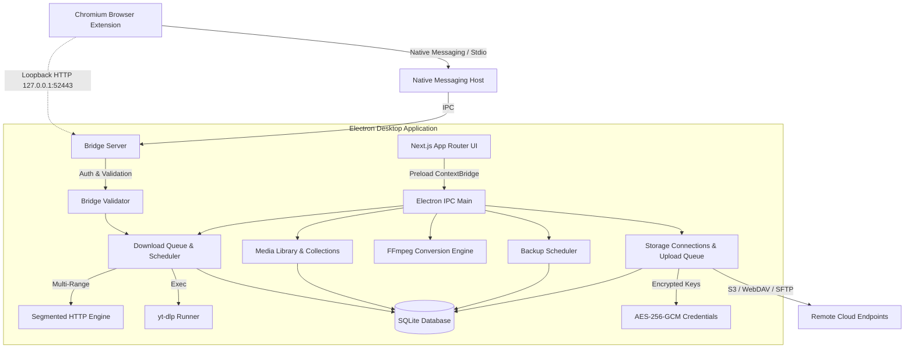

# MantiCollect — Technical Architecture & System Design

**Product:** MantiCollect — A Mantitup Product  
**Platform:** Windows Desktop Application (Electron + Next.js + SQLite + Native Messaging)

---

## 1. System Overview

MantiCollect is an offline-first, local desktop media manager and multi-protocol download system. The architecture separates untrusted inputs, network operations, local persistence, background lifecycle management, and user interface rendering into isolated, hardened boundaries.

---

## 2. Core Architectural Subsystems

### 2.1 Electron Main Process & Preload Security Boundary
* **Main Process (`electron/main.js`)**: Orchestrates window creation, tray integration, background timers, updater checks, protocol registration, and process lifecycle.
* **Context Isolation**: `contextIsolation: true` and `nodeIntegration: false` are strictly enforced for all browser windows.
* **Preload Bridge (`electron/preload.cjs`)**: Exposes a minimal, whitelist-only API via `contextBridge.exposeInMainWorld('api', { ... })`. Raw Node.js built-ins (`child_process`, `fs`, `net`, `path`) are never accessible from the renderer process.
* **IPC Channel Validation (`electron/ipc.js`)**: All inbound IPC messages from renderer windows pass through strict parameter validation, type assertions, and path containment checks (`assertPathWithin`).

### 2.2 Next.js App Router Renderer (`app/`, `src/`)
* **Framework**: Next.js App Router configured for static export (`output: 'export'`).
* **Output**: Renders directly to static HTML/CSS/JS in `dist/`, served securely inside Electron via local `file://` protocol or custom schemes with strict Content Security Policy (CSP).
* **Styling**: Vanilla CSS tokens and Tailwind CSS 4, built with a refined dark-theme design system.
* **State Management**: Local React state synchronized with Electron IPC via push events (`queue:update`, `backup:progress`, `upload:progress`).

### 2.3 SQLite Local Persistence (`electron/db.js`)
* **Engine**: `better-sqlite3` native bindings for synchronous, high-throughput, crash-safe database operations.
* **Write-Ahead Logging (WAL)**: `PRAGMA journal_mode = WAL` is enabled for high concurrency without database locking.
* **Schema**:
  * `jobs`: Download queue records, lifecycle states (`waiting`, `downloading`, `paused`, `completed`, `failed`, `cancelled`), telemetry metrics, and provider tags.
  * `media`: Indexed media library files, file hashes, MIME types, dimensions, durations, and favorites.
  * `collections` & `collection_items`: Organization playlists and categories.
  * `storage_connections`: S3, WebDAV, and SFTP endpoints (with secrets stripped).
  * `upload_tasks`: Cloud backup transfer queue.
  * `backup_schedules`: Automated recurring backup configurations.
  * `settings`: Key-value application configuration.

### 2.4 Multi-Connection Download Engine (`electron/runner.js`, `electron/bandwidth.js`)
* **Multi-Connection Segmented Engine**: For HTTP/HTTPS sources supporting `Accept-Ranges: bytes`, MantiCollect divides files into discrete byte ranges, downloads them concurrently across multiple sockets, and reconstructs the file on disk.
* **yt-dlp Integration (`electron/providers/ytdlp.js`)**: For streaming video and audio platforms, MantiCollect spawns the bundled `yt-dlp` executable with safe argv arrays, streaming real-time stdout progress.
* **Global Bandwidth Throttling**: Token bucket rate limiter (`electron/bandwidth.js`) enforces global and per-task bandwidth caps smoothly without socket starvation.

### 2.5 Media Library & Conversion Pipeline (`electron/library.js`, `electron/converter.js`)
* **Library Management**: Automatic filesystem scanning, duplicate detection, and tag filtering.
* **Conversion Engine**: Bundled `ffmpeg-static` and `ffprobe-static` binaries execute discrete format conversion tasks (MP4, MKV, MP3, AAC, FLAC, WebM), audio extraction, and metadata embedding.

### 2.6 Remote Storage & Cloud Sync (`electron/remoteStorage.js`, `electron/uploadQueue.js`)
* **Supported Protocols**:
  * **Amazon S3 / Compatible**: AWS SDK v3 client supporting AWS, Cloudflare R2, MinIO, and Backblaze B2. Uses single-part upload for files < 10MB and managed multipart upload for larger files.
  * **WebDAV**: Multi-platform WebDAV client with chunked streaming.
  * **SFTP / SSH**: Secure shell file transfer with strict host-key fingerprint verification (MITM prevention).
* **Credential Vault (`electron/credentials.js`)**: Passwords and secret keys are encrypted at rest with AES-256-GCM using machine-derived cryptographic keys.

### 2.7 Backup Scheduling (`electron/backupScheduler.js`)
* Cron-based background scheduler executes automated backups to remote cloud destinations even while the main window is closed or hidden to system tray.
* Execution history and backup snapshots are recorded in SQLite.

### 2.8 Browser Extension & Native Messaging Host
* **Extension (Manifest V3)**: Minimal permissions (`activeTab`, `storage`, `contextMenus`, `notifications`, `downloads`, `nativeMessaging`).
* **Native Messaging Host (`native-host/`)**: Chromium stdio length-prefixed IPC protocol frame relay.
* **Loopback HTTP Bridge (`electron/bridge/loopbackServer.js`)**:
  * Strictly binds to `127.0.0.1`.
  * Enforces Host header whitelist (`127.0.0.1` / `localhost`).
  * Cryptographic Bearer token authentication.
  * 64 KB payload ceiling and rate limiting.

---

## 3. Packaging & Distribution Architecture

* **Packaging Tool**: `electron-builder` with NSIS target for Windows x64.
* **Per-User Installation**: Installs to `%LOCALAPPDATA%\Programs\MantiCollect` without requiring administrative UAC prompts.
* **User Data Isolation**: User databases and configuration reside in `%APPDATA%\MantiCollect\`, isolated from program binaries and preserved across updates and uninstallation.
* **Known Packaging Limitations**:
  * In the open-source repository build, binaries are unsigned (`NotSigned`). Official signed releases require an Authenticode certificate (`CSC_LINK`).
  * Auto-updates require a trusted HTTPS update server or published GitHub Release feed.
